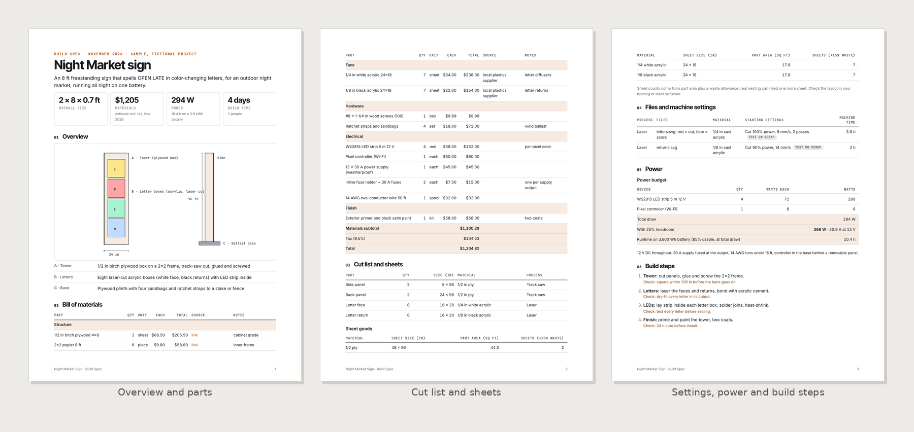
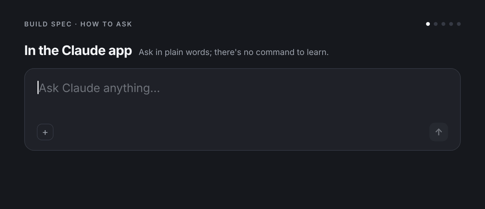

# Build Spec

Turn "here's what I want to build" into a package someone could build from: what it is, every part and what it costs, how to cut and print the parts, how much power it pulls, the order to build it in, and how to install it and take it down safely.

**What you get:** Turns a design, sketch, photo, CAD file or description of something to make into a fabrication package PDF plus a bill of materials CSV - overview diagram, parts and cut lists, sheet counts, file checklists and starting settings for laser cutting, 3D printing and CNC, hardware, a power budget with battery runtime, tools, numbered build steps with checkpoints, finishing, install and teardown, safety, vendors and a timeline. Totals come from a calculator script.



**See the full sample:** [Sample-Night-Market-Sign-Build-Spec.pdf](examples/Sample-Night-Market-Sign-Build-Spec.pdf) (fictional names and figures)

Made by Beautiful Engine · [beautifulengine.com](https://www.beautifulengine.com) · [Questions or ideas? Open an issue](https://github.com/BeautifulEngine/build-spec/issues/new)

## Install

### Claude app (web or desktop)

1. Download **[build-spec.zip](build-spec.zip)** from this repo (open the file, then use the download button). Don't unzip it.
2. Turn on **Settings > Capabilities > "Code execution and file creation"**.
3. Go to **Customize > Skills**, click **+**, then **+ Create skill > Upload a skill**, and upload the zip.
4. Start a new chat and ask in plain words. Claude picks the skill up on its own.

> GitHub's green "Code > Download ZIP" button won't work for this; it wraps everything in an extra folder. Use `build-spec.zip`.

### Claude Code

As part of the Beautiful Engine collection (you get updates and the other skills):

```bash
claude plugin marketplace add BeautifulEngine/skills
claude plugin install beautiful-engine@beautiful-engine
```

Then use `/beautiful-engine:build-spec`, or ask in plain words. Or install just this one:

```bash
git clone https://github.com/BeautifulEngine/build-spec.git
mkdir -p ~/.claude/skills && cp -r build-spec/build-spec ~/.claude/skills/
```

Then use `/build-spec`.

## Usage



```
/build-spec <what you're building> [size] [where it will live] [tools you have] [budget] [deadline]
```

Plain requests work too:

- "Build spec for an 8 ft tall LED-lit sign that says OPEN LATE, for an outdoor festival, running off a battery."
- "Here's a sketch (attached) of a DJ booth facade. Make a cut list for 1/2 in plywood."
- "Parts list and build plan for a 3D printed lamp, 300 mm tall, on a Bambu H2D."
- "Fabrication plan for this booth element from our activation deck."
- Add "quick" for a two-page version: BOM, cut list and build steps only.

## When Claude uses it

Someone asks for a build spec, fabrication plan, BOM, cut list, how to build a prop, sign, installation, booth element, art car or festival piece, or a parts list for a maker project.

## How it works

```
build-spec/
├── SKILL.md
├── assets/  base.css, deck.css, spec-template.html
├── scripts/  audit.js, bom_calc.py, contact_sheet.py, fonts.py, render.cjs, render.py, tokens.py
├── references/  rendering.md
```

PDFs are built from HTML templates, colored and typeset with the right brand, rendered by headless Chrome, then checked for fonts, text contrast and leftover blanks before delivery. Anything with numbers in it is calculated by a script, not estimated.

## Works well with

- [Activation Concepts](https://github.com/BeautifulEngine/activation-concepts)
- [Project Quote](https://github.com/BeautifulEngine/project-quote)
- [Print Listing Kit](https://github.com/BeautifulEngine/print-listing-kit)
- [All Beautiful Engine skills](https://github.com/BeautifulEngine/skills)

## Made by Beautiful Engine

Build Spec is made by [Beautiful Engine](https://www.beautifulengine.com), a creative studio in Los Angeles working across brand, experiential and interactive design.

- **Website:** [beautifulengine.com](https://www.beautifulengine.com)
- **Questions, ideas, or something broke?** [Open an issue](https://github.com/BeautifulEngine/build-spec/issues/new) and describe what you asked for and what happened.

This repo is published from [BeautifulEngine/skills](https://github.com/BeautifulEngine/skills); changes are made there and copied here.

## License

MIT. See [LICENSE](LICENSE).

